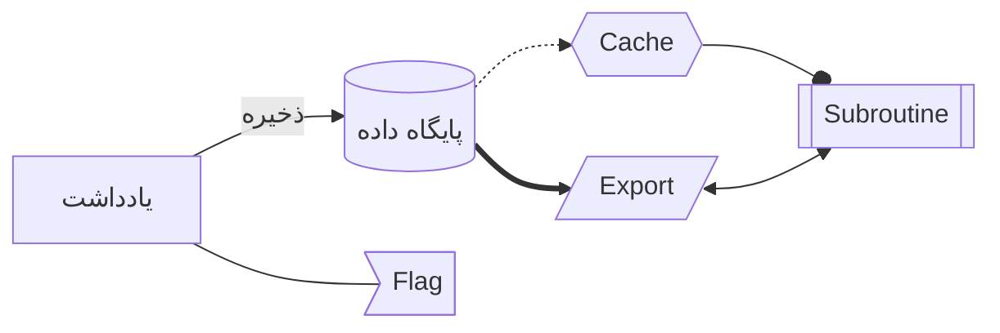
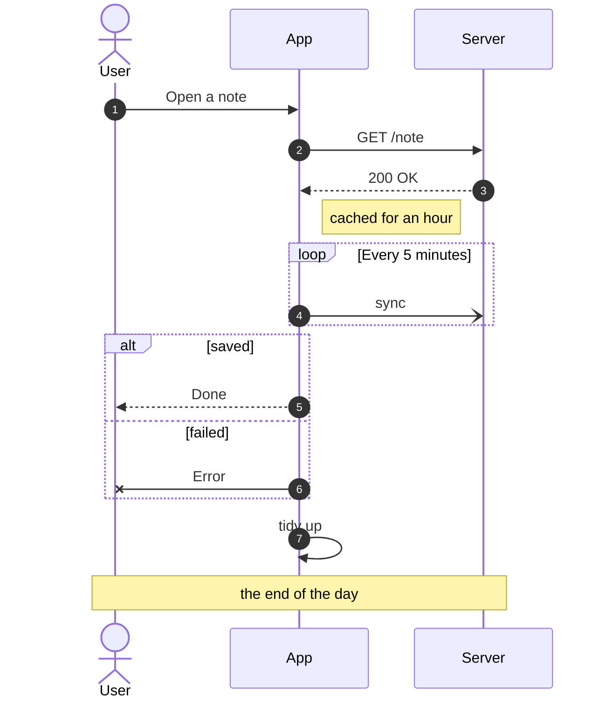
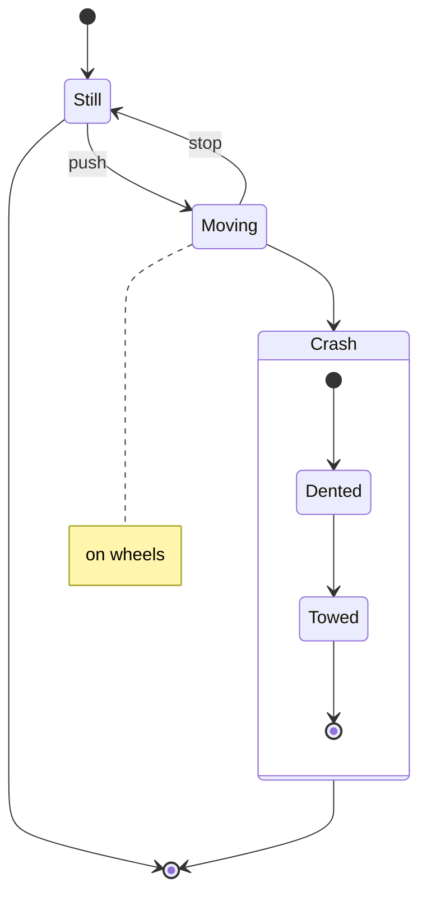
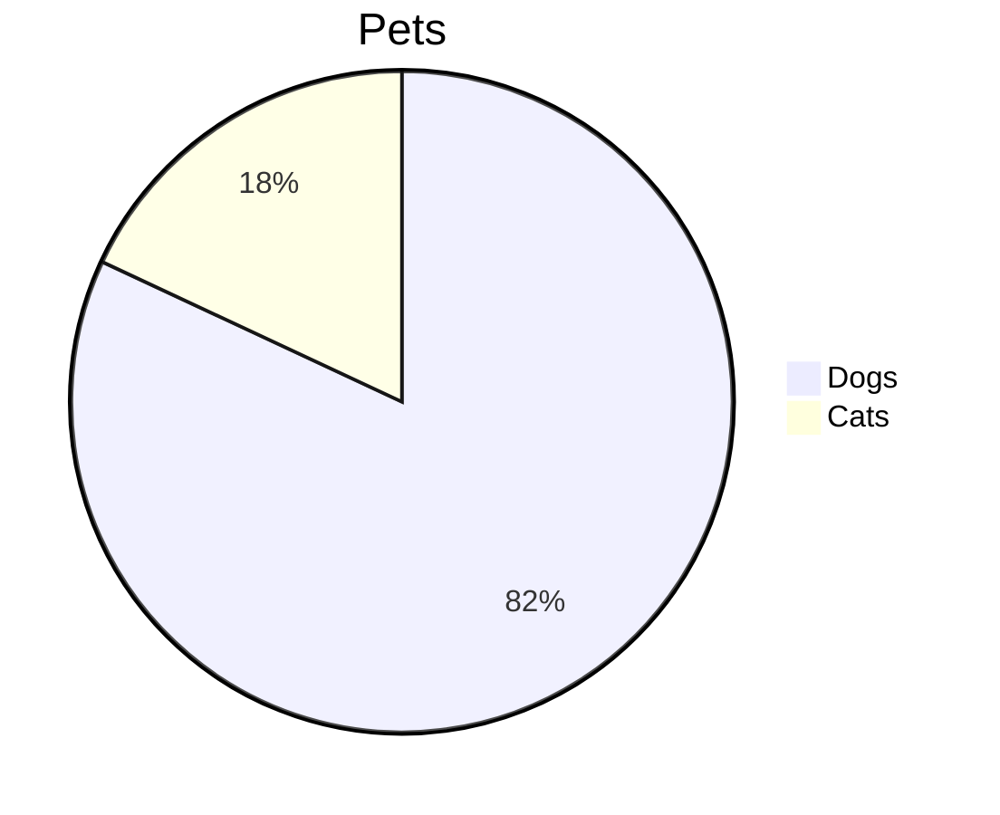

# Diagrams

A decision with a loop back:

Left to right, with Persian labels and every kind of line:

Shapes:

A sequence diagram: participants and an actor, every kind of arrow, notes, frames, numbers:

A state diagram: a start, an end, a note, and a state with states inside:

None of those, so it stays code:

